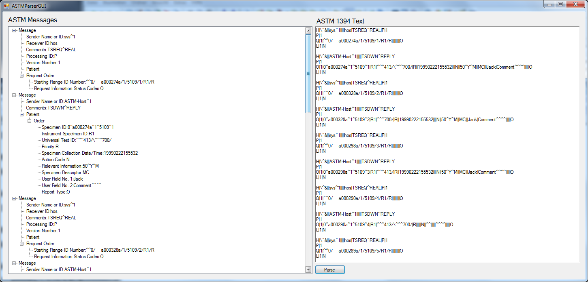

# ASTMViewer

[](LICENSE)

Small C# WinForms test program that parses ASTM E1394 (LIS2-A2) record text
and shows the records as a tree.

Status: older project (2014), not maintained. Written as a first exercise in
C#; error handling is mostly `TODO`.



## What it does

Paste ASTM record text into the text box on the right and press *Parse*. The text is
split into records by line breaks and into fields by `|`. Components (`^`),
repeats (`\`) and escape sequences are not split; E1381 framing (STX/ETX,
checksums) is not handled, so the input must be plain record lines.

Recognised record types and the tree they build:

- `H` starts a message, `L` ends it
- `P` patient, `O` order (under the last patient), `R` result (under the last order)
- `Q` request
- `C` comment and `M` manufacturer record, attached to the preceding record

Other record types are ignored. A class for `S` (scientific) records exists,
but the parser does not create it.

## Files

```
ASTMParser.cs            parser and record classes (namespace ASTMParser)
ASTMParserGUI.cs         form: text box, Parse button, tree view
Form1.Designer.cs        designer code for ASTMParserGUI
Program.cs               entry point
ASTMParser.sc.cs         earlier version of the parser inside a form; not part of the build
exe/                     prebuilt WindowsFormsApplication2.exe
```

## Build

Visual Studio project targeting .NET Framework 4.0 Client Profile. Open
`ASTMViewer.sln` in Visual Studio, or:

```bash
msbuild ASTMViewer.sln /p:Configuration=Release /p:Platform=x86
```

The output is `WindowsFormsApplication2.exe`.

## License

[MIT](LICENSE), (c) 2014 Valentin Heinitz
